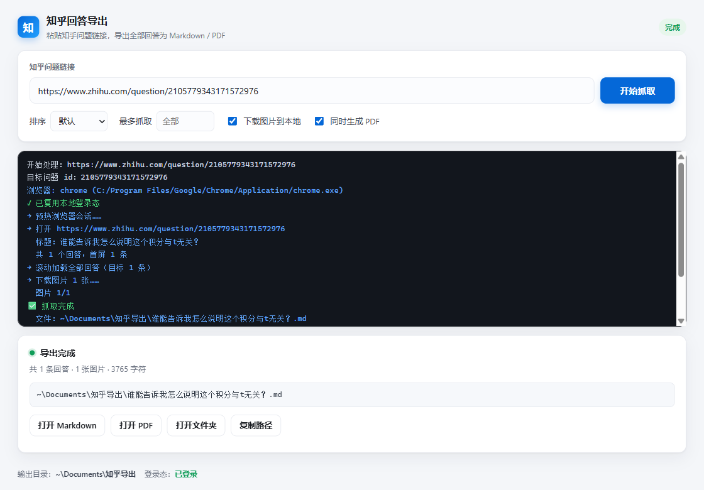

# 知乎回答导出

[](https://github.com/moyi-math/zhihu-md/actions/workflows/ci.yml)
[](https://github.com/moyi-math/zhihu-md/actions/workflows/release.yml)
[](LICENSE)

把知乎问题下的**全部回答**抓下来，导出为干净的 **Markdown** 和 **PDF**：公式变成 LaTeX、图片本地保存、代码块保留语言、表格/列表/引用正常。

打包好的单文件 Windows 客户端，双击即用；也可以在命令行里批量调用。



## 特性

- **公式不落地成图** —— 知乎的公式是图片（``），本项目按 `tex` 还原成 `$...$` / `$$...$$`，导出后是可编辑的 LaTeX
- **图片本地化** —— 下载到 `assets/`，md 用相对路径引用，离线可看，不受知乎防盗链影响
- **PDF 排版** —— KaTeX 渲染公式、图片 base64 内嵌（PDF 自包含）、A4 分页、公式/表格/代码块避免跨页截断
- **扫码登录一次** —— 登录态持久化，之后无需重复登录
- **不依赖 API 签名** —— 在真实页面里取数据（见下方「实现原理」），知乎改签名算法也不受影响
- **单文件 exe** —— 67 MB，不捆绑浏览器（复用本机 Chrome / Edge），带自定义图标与版本信息

## 快速开始

### 使用（Windows）

1. 从 [Releases](../../releases) 下载 `zhihu-md.exe` 和 `zhihu-md-launcher.vbs`（放同一个文件夹）
2. 双击 `zhihu-md-launcher.vbs`（这样不会弹命令行窗口）→ 粘贴知乎问题链接 → 开始抓取
3. 结果在 `文档\知乎导出\`

首次运行会弹出浏览器窗口，**扫码登录知乎一次**，登录态保存在 `%LOCALAPPDATA%\zhihu-md\profile`。

> 需要本机装有 Chrome 或 Edge（抓取和 PDF 渲染都要用真实浏览器）。

### 输出目录

界面里「保存到」一行可以直接改：手动输入路径（回车或点其他位置生效），或点「浏览…」用系统文件夹选择框。

- 目录不存在会自动创建，不可写/是文件/相对路径会被拒绝并回滚
- 配置保存在 `%LOCALAPPDATA%\zhihu-md\config.json`，下次启动沿用
- 命令行模式仍然用独立的 `-o/--out` 参数，不读这个配置

### 命令行

```bash
zhihu-md.exe "https://www.zhihu.com/question/2105779343171572976"
zhihu-md.exe <链接> --pdf -o D:\导出
zhihu-md.exe --help
```

| 参数 | 说明 |
| --- | --- |
| `-o, --out <dir>` | 输出目录（默认 `~/Documents/知乎导出`） |
| `--order <mode>` | `default` / `updated`（最近更新）/ `created`（按时间） |
| `--limit <n>` | 最多抓 n 条回答（默认全部） |
| `--no-images` | 不下载图片，保留知乎原链接 |
| `--pdf` | 额外生成 PDF |
| `--headless` | 无头模式（已登录时可用；知乎对无头较敏感） |
| `--profile <dir>` | 登录态目录 |
| `--max-scroll <n>` | 滚动加载次数上限（默认 500） |

## 输出

```
知乎导出/
├── <问题标题>.md
├── <问题标题>.pdf
└── assets/
    └── 4f2a...c1.jpg
```

Markdown 结构：

```markdown
---
title: "问题标题"
source: https://www.zhihu.com/question/xxx
question_id: xxx
answer_count: 20
fetched_answers: 19
fetched_at: "2026-11-18 21:01"
---

# 问题标题

> 原问题链接 · 20 个回答 · 300 次浏览

## 问题描述

## 回答目录
1. [作者](#回答-1) · 128 赞同

## 回答 1
**作者** — 一句话简介
> 128 赞同 · 12 条评论 · 发布于 2026-11-17

（正文：段落 / `$公式$` / 图片 / 代码块 / 表格）
```

## 实现原理

### 1. 为什么不直接调 API

知乎的 `/api/v4/questions/{id}/answers` 需要 `x-zse-96` 签名，直连一律返回：

```json
{"error":{"message":"请求参数异常，请升级客户端后重试。","code":10003}}
```

带正确的 cookie 也一样。所以改为在**真实的知乎问题页**里取数据：

1. 读 SSR 的 `js-initialData`（`entities.questions` + `entities.answers`）拿问题元信息和首批回答
2. 监听页面自己发出的 `/answers` 响应 —— 签名由页面 JS 完成，我们只是旁听
3. 滚动到底按需加载，用「已渲染回答卡片数」判断进度（知乎多数情况走 DOM 懒加载，接口不一定拦得到）
4. 实在没有数据时兜底读 DOM 卡片

### 2. 为什么用 Chrome 而不是 HTTP 客户端

登录后立刻用默认的无头 Chromium 请求问题页，会被风控拦成整页 403；换成真实 Chrome + 登录成功后先"逛"一下首页，就稳定得多。所以项目用 `puppeteer-core` 驱动本机 Chrome，并在登录后做一次预热。

### 3. 公式与图片的处理顺序

坑在于：如果先把 HTML 里的图片 `src` 换成本地路径，公式图就再也认不出是公式了。所以顺序必须是：

1. HTML → Markdown（此时公式已还原成 LaTeX，普通图片仍是远端 URL）
2. 再把 md 里的远端图片地址换成本地路径

图片 URL 还会以多种形式出现（`src` / `data-original` / `_720w` 与 `_1440w` 等尺寸变体），所以要做别名匹配。

### 4. 知乎 HTML 的其它坑

| 坑 | 处理 |
| --- | --- |
| 图片 `src` 是 `data:` 占位图 | 优先取 `data-original` / `data-actualsrc` |
| `<noscript></noscript>` 懒加载 | 把里面的真图提升出来 |
| 外链走 `link.zhihu.com/?target=...` | 解码还原真实地址 |
| 回答内 `h1~h3` 与文档标题冲突 | 降级并钳制在 `###` 以下 |
| 代码块 `pre[lang]` / `code.language-x` | 保留语言标注 |
| 表格 / 删除线 | GFM 插件 + 自定义 `~~` 规则 |

### 5. 打包成单文件 exe 的三个坑

- pkg 的 snapshot **不支持动态 `import()`** → 所有模块静态导入
- 打包后 CJS 依赖的 `default` 导入会变 `undefined` → 统一用 `createRequire` 加载
- snapshot 里的 KaTeX 字体，Chrome 作为外部进程**读不到** → 构建期把 woff2 内联成 base64（`make-katex-css.mjs`）

此外 `page.evaluate` 的函数回调改成字符串脚本，避免打包转换改写函数源码。

**图标与版本信息**：pkg 没有 `--icon` 参数，所以打包完成后再用 `resedit` 改 PE 资源——写入 `icon.ico`（16~256 多尺寸）以及产品名、版本号、版权，这样资源管理器「属性 → 详细信息」和任务管理器里都能看到正确的程序身份。

> 注意：GUI 窗口是 Chrome 的 `--app` 模式打开的，**任务栏图标显示的是浏览器图标**（这是无 Electron 方案换取 67MB 体积的代价）；exe 本身的图标（资源管理器、开始菜单、快捷方式）是自定义的。

## 开发

```bash
npm i
npm run gui                                  # 图形界面（本地服务 + Chrome --app 窗口）
node app.mjs <链接> --pdf -o output           # 命令行
npm test                                     # 转换层单测（10 个用例）
npm run build                                # 打包 → dist/zhihu-md.exe
```

### 结构

| 文件 | 职责 |
| --- | --- |
| `app.mjs` | 入口：无参数 → GUI（HTTP 服务 + Chrome `--app` 窗口）；带参数 → CLI |
| `cli.mjs` | 命令行参数与流程编排 |
| `zhihu-core.mjs` | 抓取核心：SSR 解析、滚动加载、图片本地化、markdown 组装 |
| `browser.mjs` | 定位系统 Chrome/Edge、启动（puppeteer-core）、图片下载 |
| `md-convert.mjs` | 知乎 HTML → Markdown（公式/图片/外链/标题层级），有单测 |
| `pdf.mjs` | Markdown → PDF（KaTeX + Chrome 打印） |
| `config.mjs` | 用户配置：输出目录的校验与持久化 |
| `make-katex-css.mjs` | 构建期把 KaTeX 字体内联成 data URI |
| `ui.html` | 图形界面（单文件，无框架） |
| `build.mjs` | 打包成单文件 exe（含图标与版本信息注入）|
| `icon.ico` / `assets-src/` | 应用图标（多尺寸）与 512px 源图 |
| `test-md-convert.mjs` | 转换层单测（公式/图片/外链/标题/代码块/表格等 11 个用例）|
| `.github/workflows/` | CI：push 跑单测；打 tag 自动构建 exe 并发布 Release |

发版：`git tag v1.0.0 && git push --tags`，GitHub Actions 会自动构建 exe、生成 SHA256 并发布 Release。

技术栈：Node.js 22+ / `puppeteer-core` / `turndown` / `markdown-it` / `katex` / `@yao-pkg/pkg`。

## 安全模型

GUI 是一个监听 `127.0.0.1` 随机端口的本地服务，所以做了三道限制，防止**本机其他网页**（例如被注入脚本的页面）驱动本程序：

- 启动时生成一次性 token，页面地址带 `?t=<token>`；页面本身和所有 `/api/*` 都校验 token
- 额外校验 `Host` 与 `Origin`，挡住 DNS rebinding 与跨站表单/fetch
- `/api/open`、`/api/pdf` 只接受输出目录内的路径，且打开文件走 `explorer.exe`（ShellExecute 语义），不经过 `cmd.exe` 命令行解析

## 已知限制

- **被折叠的回答抓不到**：按页面可见内容抓取。若知乎显示 20 条而只抓到 18 条，md 末尾会注明「知乎显示共 20 条，其中 2 条已被折叠」。
- 回答内嵌视频只保留跳转链接。
- 回答极多（上千条）的问题滚动较慢，可用 `--limit` 截断。
- 登录态被临时风控时（页面直接返回 40362），删掉登录态目录重新扫码，或稍后重试。
- exe 不捆绑浏览器，因此需要本机装有 Chrome 或 Edge。

## 免责声明

本项目仅用于**个人学习与技术研究**，抓取内容的著作权归原作者所有。

- 请遵守[知乎用户协议](https://www.zhihu.com/terms)与 `robots.txt`，不要高频抓取
- 抓取结果仅供个人离线阅读，**请勿二次公开传播或用于商业用途**
- 程序内置了滚动间隔与请求节流，请勿调低这些值

使用本工具产生的任何后果由使用者自行承担。

## License

MIT
